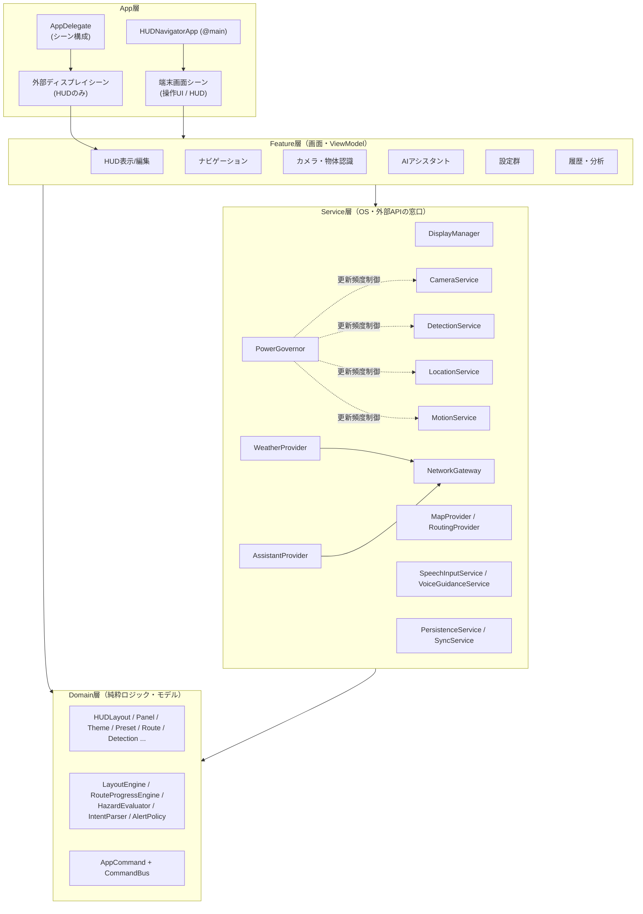
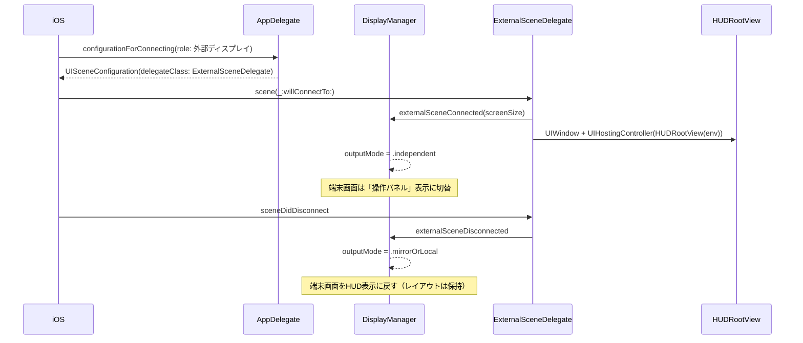
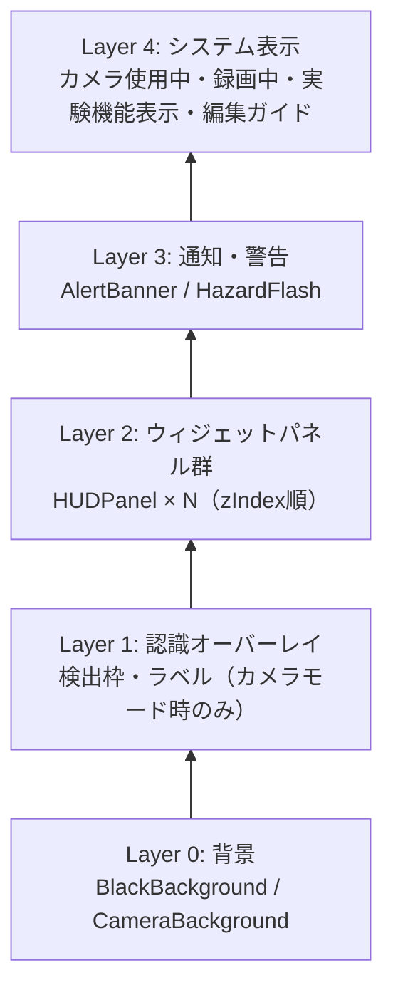

# 04. アーキテクチャ設計

## 1. 設計原則

1. **HUDの描画は1か所**（`HUDRootView`）。端末画面にも外部画面にも同じViewを載せる → ミラーリング／独立画面のどちらでも成立。
2. **状態は1つ**（`AppState`）。外部画面と端末画面は同じ状態を参照する（2重管理しない）。
3. **サービスはプロトコルで抽象化**。地図エンジン、天気、同期、AIを差し替え可能にする（Google Maps・CloudKit・クラウドAIの後付け対応）。
4. **ハードウェア依存は Service 層に閉じ込める**。View はセンサーやカメラを直接触らない。
5. **ロジックは純粋関数に寄せる**（レイアウト計算、ルート進捗、意図解析、危険度判定）→ テストしやすい。
6. **電力・発熱を一元管理**（`PowerGovernor`）。各サービスの更新頻度を状況に応じて下げる。
7. **安全・プライバシーを設計で担保**：外部送信は `NetworkGateway` 経由のみ、送信内容はログに残しユーザーが確認できる。

## 2. 全体構成（レイヤー）



## 3. 外部ディスプレイ構成



**出力モード（`DisplayOutputMode`）**

| モード | 端末画面 | グラス | 使う場面 |
|--------|----------|--------|----------|
| `.local` | HUD | なし | グラス未接続 |
| `.mirror` | HUD（フルスクリーン黒背景）＋最小限の操作 | 端末画面のミラー | 独立画面が使えない環境（Swift Playgrounds内実行の可能性） |
| `.independent` | 操作パネル（編集・地図・設定） | HUD専用 | 独立画面が使える環境 |

ユーザーは設定画面で「自動／ミラー固定」を選べる。

## 4. HUD レイヤー構造



- 背景とHUDは完全に独立したレイヤー（計画書 §3-1）。
- Layer 4 は常に最前面で、ユーザー設定で非表示にできない（カメラ使用中表示など §19）。

## 5. 主要データモデル（概要）

```swift
// 概念設計（実装時に調整）
struct HUDLayout: Codable, Identifiable { id; name; panels: [HUDPanel]; canvas: CanvasSettings }
struct HUDPanel: Codable, Identifiable {
    id; widget: WidgetKind; config: WidgetConfig
    frame: NormalizedRect      // 0.0〜1.0 の正規化座標
    zIndex: Int; isVisible: Bool; opacity: Double
    styleOverride: PanelStyle? // nil ならテーマに従う
}
struct Theme: Codable, Identifiable { id; name; text: ColorToken; background: ColorToken; font: FontSpec; border; cornerRadius; shadow; glow; animation }
struct Preset: Codable, Identifiable { id; name; layout: HUDLayout.ID; theme: Theme.ID; background: BackgroundMode; features: FeatureToggles }
enum WidgetKind: String, Codable { clock, date, battery, speed, compass, miniMap, weather, temperature, precipitation, distance, eta, notifications, gpsStatus, sensors, assistant, nextTurn }
enum BackgroundMode: String, Codable { black, camera }
enum AppCommand { setBackground(BackgroundMode), applyPreset(String), startNavigation, stopNavigation, showWidget(WidgetKind), zoomMap(Double), toggleVoiceGuidance(Bool), ... }
```

- **音声操作・ショートカット・UIボタンは全て `AppCommand` を発行**し、`CommandBus` が実行する → 「可能な限り多くの操作を音声で」を自然に満たす。
- `WidgetKind` ごとに `WidgetRegistry` が「表示View」「設定View」「必要なサービス」を返す → ウィジェットを追加しやすい（計画書 §12）。必要なサービスはウィジェットが表示されている間だけ起動する（省電力）。

## 6. 並行性（Swift 6）

| 対象 | 方針 |
|------|------|
| `AppState`、ViewModel、`DisplayManager` | `@MainActor` |
| カメラフレーム処理・推論 | 専用の `actor DetectionPipeline`（またはシリアルキュー）。結果だけを MainActor に渡す |
| センサー | `AsyncStream<T>` で配信。値型（`Sendable` な struct）のみ受け渡し |
| ネットワーク | `async` 関数。`NetworkGateway` は `actor` |

## 7. 電力・発熱制御（PowerGovernor）

入力：`thermalState`、バッテリー残量、低電力モード、表示中ウィジェット、背景モード
出力：各サービスの「品質レベル」

| レベル | カメラ | 推論 | 位置 | モーション | ミニマップ |
|--------|--------|------|------|-----------|-----------|
| 通常 | 30fps / 1080p | 10fps | 最高精度 | 30Hz | 1Hz |
| 節約 | 30fps / 720p | 5fps | ナビ時のみ高精度 | 10Hz | 0.5Hz |
| 高温・低残量 | 停止を提案 | 2fps or 停止 | 低精度 | 5Hz | 停止 |

数値は初期値。Phase 7 の計測で調整する。

## 8. プライバシー設計

- 外部通信は `NetworkGateway` のみ。通信先・目的・送信データの種類を「通信ログ」画面で確認できる。
- カメラ映像・位置座標は **既定で外部送信しない**。クラウドAIに送る場合は送信内容をユーザーに示して同意を取る。
- 履歴の保存は既定 OFF。ON にした場合も「保存期間」「全削除」を提供。
