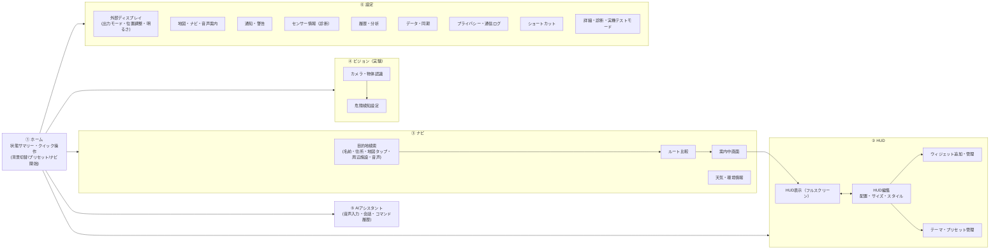

# 06. 画面構成図

計画書 §16 の18画面を、**6つの入口（タブ／サイドバー）＋設定内のサブ画面**に整理する（「画面数を増やしすぎない」方針）。

## 1. 画面遷移

## 2. 計画書の画面との対応

| 計画書 §16 | 本設計での位置 |
|-----------|---------------|
| 1 ホーム | ① ホーム |
| 2 HUD表示 | ② HUD表示 |
| 3 HUD編集 | ② HUD編集 |
| 4 ナビゲーション | ③ ナビ（検索・ルート比較・案内中） |
| 5 地図設定 | ⑥ 地図・ナビ・音声案内 |
| 6 AIアシスタント | ⑤ AIアシスタント |
| 7 カメラ・物体認識 | ④ ビジョン |
| 8 センサー情報 | ⑥ センサー情報（診断） |
| 9 ウィジェット管理 | ② ウィジェット追加・管理（HUD編集から） |
| 10 テーマ管理 | ② テーマ・プリセット管理 |
| 11 履歴・分析 | ⑥ 履歴・分析 |
| 12 天気・環境情報 | ③ 天気（ナビ内）＋ HUDウィジェット |
| 13 通知設定 | ⑥ 通知・警告 |
| 14 外部ディスプレイ設定 | ⑥ 外部ディスプレイ |
| 15 データ・同期 | ⑥ データ・同期 |
| 16 プライバシー | ⑥ プライバシー・通信ログ |
| 17 ショートカット | ⑥ ショートカット |
| 18 詳細設定 | ⑥ 詳細・診断 |

## 3. 端末ごとのレイアウト

| 状況 | iPad A16 | iPhone 15 |
|------|----------|-----------|
| 通常 | `NavigationSplitView`（サイドバー＋詳細） | `TabView`（5タブ：ホーム/HUD/ナビ/ビジョン/設定、アシスタントは全画面共通のマイクボタン） |
| 独立外部画面あり | 端末：操作パネル、グラス：HUD | 同左 |
| ミラーモード | 端末：HUDフルスクリーン＋端に小さな操作ハンドル（長押しで操作メニュー） | 同左（横向き推奨） |

## 4. HUD表示中の操作（グラス装着時）

グラス装着中は端末画面を見にくいため、以下の「見ないで使える」操作を用意：
- 音声コマンド（マイクボタン or 常時待受は電力の都合でOFFが既定）
- 端末画面の大きなジェスチャー領域（左右スワイプ＝プリセット切替、2本指タップ＝背景切替、長押し＝メニュー）
- ショートカット（App Intents が使える場合）
