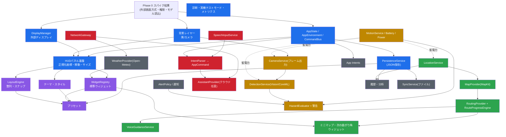

# 07. 機能依存関係図

矢印は「A → B」＝「B は A が完成していることを前提とする」。

## クリティカルパス

1. **S0-1（外部ディスプレイ方式の確定）→ DisplayManager → HUDパネル基盤**
   ここが決まらないと HUD 全体の作り方（端末画面の役割）が決まらない。
2. **LocationService → RoutingProvider → RouteProgressEngine → 音声案内**
   ナビ機能の骨格。iPad Wi-Fi モデルでは GPS 精度の検証ができないため、**位置のシミュレーション再生（記録したGPXの再生）** を先に用意する。
3. **CameraService(フレーム出力) → DetectionService → HazardEvaluator**
   Phase 4。モデルのライセンス確定と S0-5（モデル読込）が前提。

## 独立して並行できるもの

- テーマ・デザイン（Phase 2）と、ナビのロジック（RouteProgressEngine）は互いに依存しない。
- IntentParser（音声コマンド解析）は純粋ロジックなので、音声認識より先に作ってテキスト入力でテストできる。
- Open-Meteo 連携は他機能と独立。
