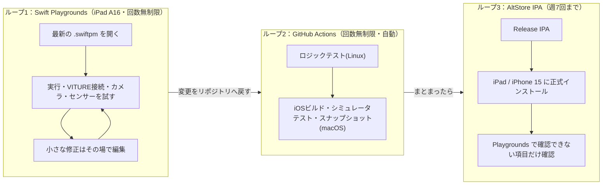
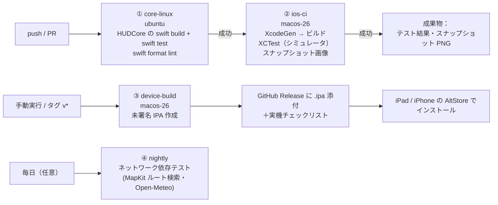

# 13. ビルド・検証パイプライン（GitHub Actions ＋ AltStore）

改訂：2026-11-09
- ユーザー指示「検証は AltStore を使うが週7回程度なので、大半は GitHub Actions で済ませる」を反映
- Q11 回答「回数無制限の Swift Playgrounds でたくさんテストし、最後に IPA にしたり機能追加したりする。または Windows で」を反映 → **§0 の3ループ構成**

## 0. 3つの検証ループ（回数の制限が少ない順）



| ループ | 回数 | 主に確認すること |
|--------|------|------------------|
| 1. Swift Playgrounds（iPad） | **無制限** | HUD の見た目・操作感、VITURE（ミラー表示）での視認性、カメラ背景、センサー値、MapKit、音声 — **iPad で動くものはほぼ全部ここで先に試す** |
| 2. GitHub Actions | 無制限（自動） | ロジックの正しさ、iOS ビルドが壊れていないか、見た目の回帰（スナップショット） |
| 3. AltStore IPA | **週7回まで** | **iPhone 15 での動作**（Playgrounds は iPhone 非対応）、外部ディスプレイの独立表示、ショートカット、バックグラウンド動作など **正式アプリでしか動かない機能** |

### Windows PC の使いどころ（任意）
- **AltServer for Windows**：AltStore の7日ごとの署名更新・IPA インストール
- コード編集（VS Code 等）と GitHub への push
- ロジック部分（`HUDCore`）は Swift for Windows でテスト可能【要動作確認】。**iOS アプリのビルドは Windows ではできない**（GitHub Actions の macOS で行う）

## 1. 方針の変更点

| 項目 | 旧計画 | 新計画 |
|------|--------|--------|
| ビルド | iPad の Swift Playgrounds のみ | **Swift Playgrounds（試作・日常テスト）＋ GitHub Actions（正式ビルド）の両対応** |
| プロジェクト形式 | `.swiftpm`（Playgrounds 用） | **同じソースを `.swiftpm`（Playgrounds 用）と XcodeGen `project.yml`（CI 用）の両方から参照**（§9） |
| 実機インストール | Playgrounds 内実行／TestFlight（有料） | Playgrounds 内実行（iPad・無制限）＋ **CI が作った未署名 IPA を AltStore で署名・インストール** |
| iPhone 15 対応 | 有料 Program か Mac が必要 | **AltStore で iPhone にインストール** |
| テスト | アプリ内セルフテストのみ | **XCTest（Linux＋iOS シミュレータ）＋ スナップショット画像＋ Playgrounds での手動確認＋ 実機チェックリスト** |
| 実機検証の回数 | 制約なし | IPA は **週7回程度まで** → 正式アプリでしか分からない項目だけ |

## 2. これで解消・改善する制約

| 旧制約（Playgrounds 由来） | 新状況 |
|----------------------------|--------|
| Info.plist を直接編集できない | `project.yml` で自由に設定（外部ディスプレイ用シーン、権限説明、バックグラウンドモード） |
| 外部ディスプレイ独立表示が Playgrounds 内で動くか不明（R-01） | 通常アプリとしてインストールされるため **動く可能性が高い**（実機で確認は必要） |
| XCTest が使えない | 使える（CI で自動実行） |
| `.mlmodel` のコンパイル | Xcode がビルド時にコンパイル |
| App Intents が動くか不明 | Xcode のビルドでメタデータが生成されるため **動く可能性が高い** |
| iPhone 15 へのインストール経路（R-02） | AltStore で解消 |
| Swift Package のバイナリ依存 | 利用可能（Google Maps SDK 等を入れる場合） |

## 3. 残る制約（無料 Apple ID ＋ AltStore）

| 制約 | 内容 | 設計上の対応 |
|------|------|-------------|
| 署名の有効期限 | 無料 Apple ID の署名は **7日** で切れる【確認済】 | AltServer（Mac/Windows PC、同一Wi-Fi）での更新、または AltStore のバックグラウンド更新。2026年5月に PC 不要の端末内サイドロードが発表されたとの報道あり【詳細未確認】 |
| 同時に使えるアプリ数 | 無料アカウントは **同時3本まで** とされる（AltStore 自体を含む）【第三者情報・要確認】 | 本アプリは1本に収める |
| App ID の登録数 | 無料アカウントは **7日あたりの App ID 登録数に上限** があるとされる（10件と言われる）【未確認】 | **App Extension（ウィジェット等）を作らない**。Bundle ID を固定して使い回す |
| エンタイトルメント | 無料アカウントでは iCloud/CloudKit・WeatherKit・プッシュ通知などは使えない | 旧計画どおり代替（ファイル同期・Open-Meteo・ローカル通知） |
| CI での署名 | GitHub Actions では Xcode の自動署名が使えない【確認済】 | **CI は未署名でビルド**（`CODE_SIGNING_ALLOWED=NO`）、署名は AltStore が行う |
| 未署名 IPA を AltStore が受け付けるか | 一般的な手順だが本プロジェクトでは未検証【要実機検証】 | Phase 0 の最初に確認（S0-0） |
| Apple Watch アプリ | AltStore での watchOS アプリ導入は想定しない | D のまま |

## 4. ワークフロー構成

公開リポジトリのため、GitHub ホストランナー（macOS 含む）は無料で使える。それでも macOS ランナーは遅く台数も限られるため、**速い Linux ジョブで先にふるい落とす**。



| ワークフロー | トリガー | ランナー | 内容 | 目安時間 |
|-------------|----------|----------|------|----------|
| `core-linux.yml` | すべての push / PR | `ubuntu-latest` | `HUDCore`（純粋ロジック）のビルド・テスト、フォーマット確認 | 1〜3分 |
| `ios-ci.yml` | PR・main への push（①成功後） | `macos-26`（Xcode を固定指定） | XcodeGen でプロジェクト生成 → iOS ビルド → シミュレータで XCTest → HUD スナップショット PNG をアーティファクトに保存 | 10〜20分 |
| `device-build.yml` | 手動実行（workflow_dispatch）／`v*` タグ | `macos-26` | Release 構成・未署名でビルド → `Payload/HUDNavigator.app` を zip 化して `.ipa` → GitHub Release に添付 | 10〜15分 |
| `nightly.yml` | 1日1回（任意） | `macos-26` | 外部ネットワークに依存するテスト（失敗しても PR をブロックしない） | 10分 |

Xcode のバージョンは `xcode-select` で固定し、ランナーイメージの既定値の変化に左右されないようにする。

## 5. GitHub Actions で検証できること／できないこと

| 検証項目 | CI（Linux） | CI（iOS シミュレータ） | 実機（AltStore） |
|----------|:----------:|:--------------------:|:---------------:|
| HUD レイアウト計算・整列・保存/読込 | ✅ | ✅ | — |
| ルート進捗・逸脱検知・読み上げタイミング（GPX 再生） | ✅ | ✅ | 屋外で最終確認 |
| 音声コマンド解析（テキスト入力） | ✅ | ✅ | — |
| 危険度判定（記録データ入力） | ✅ | ✅ | — |
| 通知の優先度・抑制 | ✅ | ✅ | — |
| HUD の見た目（1920×1080 / iPad / iPhone サイズの PNG） | — | ✅ スナップショット | グラス越しの見え方 |
| テーマ・プリセットの描画崩れ | — | ✅ | — |
| 物体認識の精度（固定画像・動画で回帰テスト） | — | ✅（CPU 推論） | 実際の fps・発熱 |
| MapKit 検索・ルート取得 | — | △ nightly（ネットワーク依存） | ✅ |
| 外部ディスプレイのシーン生成ロジック | — | △ 単体テストのみ | ✅ **VITURE 実機** |
| カメラ映像・遅延 | — | ❌ シミュレータにカメラなし | ✅ |
| GPS・コンパス・加速度・ジャイロの実測 | — | ❌ | ✅ |
| 音声認識（マイク） | — | ❌ | ✅ |
| 発熱・電池・実 fps | — | ❌ | ✅ |
| 権限ダイアログ・実際のインストール | — | △ | ✅ |

目標：**ロジック・見た目の不具合は CI で 9割以上止め、実機は「ハードウェアでしか分からない項目」の確認に使う。**

## 6. 実機検証の回数配分（週7回まで）

| 回 | 用途 |
|----|------|
| 週1〜2回 | その週の成果をまとめた Release IPA の確認（チェックリスト一括実施） |
| 週1回 | 署名の更新（7日期限）— 新しい IPA の入れ替えと兼ねる |
| 残り | 不具合修正の確認・屋外テスト用の予備 |

- 毎回の Release に「今回の実機チェックリスト」（変更点に関係する項目だけ）を添付する。
- アプリ内に **実機テストモード** を用意：チェック項目の合否・計測値（fps・温度推移・電池・GPS精度）を記録し、**JSON レポートとして書き出し**できるようにする。
- ユーザーはそのレポートを GitHub Issue に添付（またはテキストで貼り付け）→ こちらで解析し、次の修正に反映。

## 7. AltStore への受け渡し手順

### 7-1. AltStore のソース（実装済み）
CI がビルドごとに AltStore のソース（JSON）を作り、Release「latest」に添付する。URL は変わらない：

```
https://github.com/prak59459-create/VitureHUD/releases/download/latest/altstore-source.json
https://github.com/prak59459-create/VitureHUD/releases/download/latest/altstore-source-widgets.json  （ウィジェット付き）
```

- AltStore →「ソース」→「＋」で URL を追加すると、AltStore の中からインストール・更新できる
- バージョンはビルドごとに `0.2.<ビルド番号>`（CFBundleVersion＝ビルド番号）に上がるので、新しいビルドは「更新」として届く
- 権限（`appPermissions.privacy`）は、ビルドした .app の Info.plist の `…UsageDescription` をそのまま載せる（AltStore は宣言と IPA の中身が一致しないとインストールを断るため）。entitlement は無し（署名なしでビルドし、AltStore が署名する）
- アイコン（icon.png）とスクリーンショット（シミュレータで作った HUD の画像）も Release に添付
- 生成：`scripts/altstore_source.py`（JSON）、`scripts/altstore_assets.sh`（アイコン・スクリーンショット・2 種類の JSON）
- 注意：Release「latest」はビルドのたびに作り直すため、作り直しの数秒間は URL が見つからないことがある

### 7-2. ファイルで入れる場合
1. GitHub の Releases ページを iPad / iPhone の Safari で開き、`.ipa` をダウンロード（ファイルアプリに保存）
2. AltStore の「マイApp」→「＋」から `.ipa` を選択してインストール
3. 7日以内に AltStore で更新（AltServer の起動した PC と同じ Wi-Fi）

## 8. セキュリティ・公開リポジトリの注意

- リポジトリ・Release・アーティファクトは **公開** される。APIキー・個人情報（自宅周辺の GPX など）を含めない。
- テスト用 GPX は架空ルートか公共の場所のみで作る。実機テストレポートの位置情報は、Issue に貼る前に丸める（アプリの書き出し機能で既定ON）。
- サードパーティ製 Action は最小限にし、使う場合はコミット SHA で固定する。

## 9. 1つのソースを Swift Playgrounds と CI の両方でビルドする設計

### 9-1. 構成

```
VitureHUD/
├── Package.swift                 ← Linux/Windows/CI 用：HUDCore をテストするためだけのパッケージ
│                                    （target HUDCore の path = "HUDNavigator.swiftpm/Core"）
├── Tests/HUDCoreTests/           ← ロジックテスト
├── project.yml                   ← XcodeGen：CI で正式アプリ（IPA）をビルド
│                                    （sources = HUDNavigator.swiftpm/Core と /App）
└── HUDNavigator.swiftpm/         ← iPad の Swift Playgrounds でそのまま開くアプリ
    ├── Package.swift             ← Playgrounds 用（AppleProductTypes、Capabilities）
    ├── Core/                     ← 純粋ロジック（Foundation のみ）
    └── App/                      ← SwiftUI / UIKit / AVFoundation など
```

- **ソースは1か所（`HUDNavigator.swiftpm/` の中）だけ**。3つのビルド定義（Playgrounds 用・テスト用・CI 用）がそれを参照する → 二重管理にならない。
- Playgrounds では Core と App が1つのモジュールになるため、App から `import HUDCore` は書かない（CI 側も同じく1モジュールでビルドする）。テストだけが `@testable import HUDCore` を使う。

### 9-2. 正式ビルドでしか動かない機能の切り分け

CI（XcodeGen）側だけにコンパイル条件 `FULL_BUILD` を設定し、Playgrounds で問題になりうる機能を分ける。

| 機能 | Playgrounds 実行時 | 正式ビルド（IPA） |
|------|-------------------|------------------|
| 外部ディスプレイ | ミラー表示（独立表示も試み、ダメなら自動でミラー） | 独立表示 |
| 権限説明 | Playgrounds の Capabilities 設定 | `project.yml` の Info.plist |
| Core ML モデル | 実行時コンパイル（`MLModel.compileModel`） | ビルド時コンパイル済みを使用 |
| App Intents（ショートカット） | `#if FULL_BUILD` で無効 | 有効 |
| バックグラウンド動作 | 無効（前面のみ） | Info.plist で有効化 |

### 9-3. Playgrounds とリポジトリの間の受け渡し

| 方向 | 方法 |
|------|------|
| リポジトリ → iPad | CI が毎回 **`HUDNavigator.swiftpm.zip` を作ってアーティファクト／Release に添付** → iPad の Safari でダウンロード → ファイルアプリで展開 → Swift Playgrounds で開く |
| iPad → リポジトリ（自分で直した場合） | (a) 直した内容を GitHub Issue / チャットに貼る（小さい修正向け）、(b) iPad の Git クライアント（Working Copy 等、push は有料機能の可能性あり）、(c) Windows PC にファイルを移して push |

Playgrounds で試した結果（OK/NG・気づき）は、アプリの「実機テストモード」の JSON 書き出しで共有できる（IPA と同じ仕組み）。

### 9-4. 両対応を守るための CI チェック

- `HUDNavigator.swiftpm` を **そのまま `xcodebuild` でビルドできるか** を CI で確認する【要検証：S0-P】。できない場合も、少なくとも「Playgrounds の Swift 言語版・最低 iOS 版で使えない API を使っていないか」を確認する。
- `project.yml` と `.swiftpm/Package.swift` の権限設定（カメラ・位置・マイク等）が一致しているかをスクリプトで確認する。

## 参照
- [macOS 26 が GitHub ホストランナーで一般提供（GitHub Changelog）](https://github.blog/changelog/2026-02-26-macos-26-is-now-generally-available-for-github-hosted-runners/)
- [macOS 26 runners と xcode-select（Depot）](https://depot.dev/blog/now-available-macos-26-github-actions)
- [GitHub Actions での iOS ビルドと Xcode バージョン固定（issoh）](https://www.issoh.co.jp/md/tech/2367)
- [GitHub Docs：macOS ランナーへの証明書インストール（自動署名非対応の説明）](https://docs.github.com/en/enterprise-server@3.5/actions/deployment/deploying-xcode-applications/installing-an-apple-certificate-on-macos-runners-for-xcode-development)
- [AltStore 概要（SourceForge）](https://sourceforge.net/app/altstore/) / [AltServer リリースノート](https://faq.altstore.io/release-notes/altserver) / [AltStore FAQ](https://faq.altstore.io/altstore-world/your-altstore)
- [AltStore が PC 不要の端末内サイドロードを開始（AlternativeTo, 2026-05）](https://alternativeto.net/news/2026/5/altstore-launches-on-device-app-sideloading-without-a-computer-or-altserver/)
- [AltStore の3本制限について（Tenorshare・第三者）](https://www.tenorshare.com/ios-app/how-to-sideload-more-than-3-apps-altstore.html)
